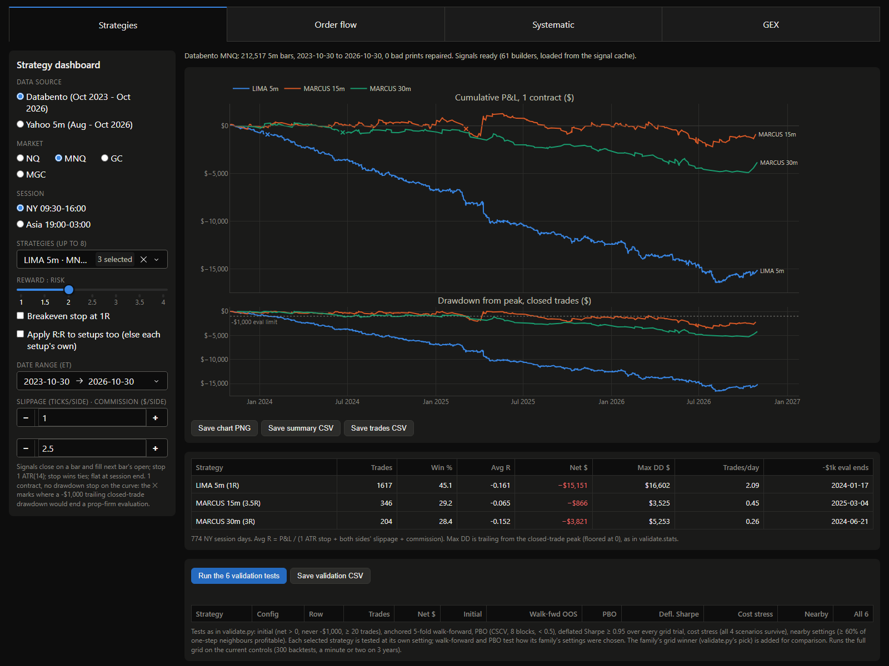
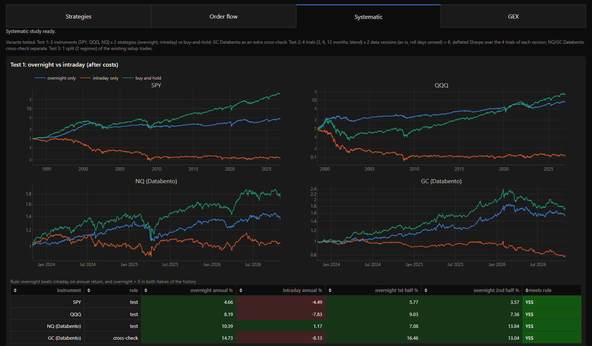
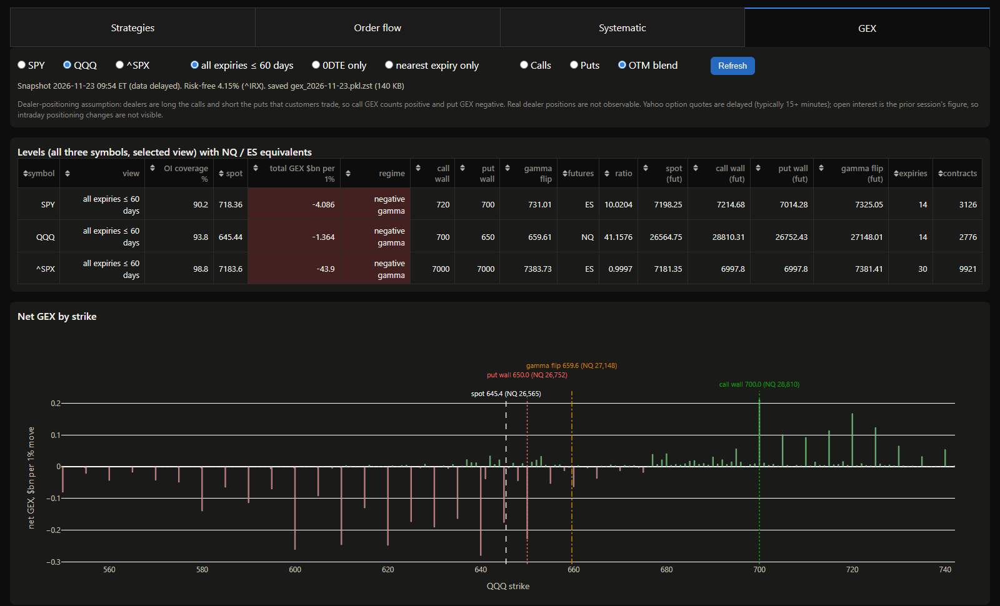
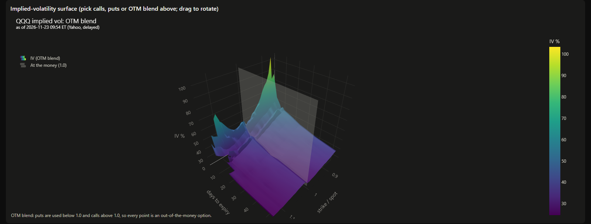

# Trading Research

A backtesting and validation framework for intraday futures strategies on Nasdaq (NQ / MNQ) and gold (GC / MGC), covering the New York session (09:30–16:00 ET) and the Asia session (19:00–03:00 ET).

The project's purpose is to find out whether a strategy has an edge before any money goes on it, and to make it hard to fool yourself. Most of the code is about testing, not about generating signals.

## Main finding

**No strategy showed a reliable edge after costs.** The work ran in three rounds, all with the same engine and costs: 1 micro contract (MNQ or MGC), fill at the next bar's open plus 1 tick of slippage, $2.50 commission per side, a 1 ATR stop, and flat by session end.

1. **Screening: 13 strategy families, 1,200 configurations, 50 days.** Yahoo 5-minute data, Aug 21 – Oct 30 2026, MNQ and MGC, NY and Asia sessions. The families were common discretionary and "ICT"-style setups: opening-range breakouts, fair value gaps, order blocks, break of structure, Bollinger/RSI mean reversion, anchored VWAP bands, momentum and others. **0 of 52 market/session/family combinations passed all six tests.** The deflated Sharpe test failed in all 52, and the best three passed 5 of 6.
   → [`results/validation_2026-11-11/pass_fail_summary.csv`](results/validation_2026-11-11/pass_fail_summary.csv), [`all_configs.csv`](results/validation_2026-11-11/all_configs.csv)
2. **Three-year check of the chosen setups.** The 18 setups picked from round 1 (from 7 of the 13 families), plus one volume-profile setup, were run on Databento 1-minute data, Oct 30 2023 – Oct 30 2026, each on its own market, session and reward:risk. There were 20 rows, counting two versions of the volume-profile setup. **Only 1 of 20 had a positive average R: an opening-range breakout at +0.02R per trade (+0.10R in 2024, −0.04R in 2025, +0.002R in 2026). None had a positive average R in each of 2024, 2025 and 2026.** 3 of 20 were net positive in dollars ($476 to $1,091 over three years), all with negative or near-zero average R. The best simulated pass rate for a 25K evaluation account was 23%.
   → [`results/setup_report/setups.csv`](results/setup_report/setups.csv)
3. **Volume-profile grid: 180 configurations, same three years.** 3 families × 3 value-area widths × 5 reward:risk ratios, on MNQ and MGC, NY and Asia. **4 of 180 were net positive, 1 had a positive average R in both 2024 and 2025, and none in all three years.**
   → [`results/setup_report/vp_grid.csv`](results/setup_report/vp_grid.csv)

Rounds 2 and 3 come from `python code/setup_report.py setups vp`. This negative result is what the framework is for. A short sample with hundreds of parameter combinations will always throw up a few winners by chance: round 1's "5 of 6" candidates looked promising on 50 days and didn't hold up over three years.

Order-flow confirmation (trade-by-trade data with aggressor side) and a few systematic ideas (overnight vs intraday returns, time-series momentum, VIX regimes) were tested afterwards. Results and caveats are written up in [`docs/`](docs/).

## Testing standards

Every strategy goes through the same engine ([`code/nq_backtest.py`](code/nq_backtest.py)) and test harness ([`code/validate.py`](code/validate.py)):

| Rule | What it means |
|---|---|
| **Next-bar fills** | Signals form on a closed bar and fill at the next bar's open, plus 1 tick of slippage. No trading on information that wasn't available yet. |
| **Costs** | $2.50 commission per side on every trade. |
| **Conservative stops** | Stop = 1 ATR(14). If stop and target are both touched in the same bar, the stop is assumed to hit first. |
| **Lookahead test** | [`code/lookahead.py`](code/lookahead.py) deletes future bars and checks that past signals don't change. Every signal generator must pass. |
| **Walk-forward** | Anchored, 5 folds: parameters chosen only on earlier data, then scored on the next unseen block. |
| **PBO** | Probability of backtest overfitting (combinatorially symmetric cross-validation, 8 blocks). Must be below 0.5. |
| **Deflated Sharpe ratio** | Sharpe adjusted for how many configurations were tried. Must be at least 0.95. |
| **Cost stress** | Re-run at 1.5 and 2 ticks of slippage, at $3.75 commission, and at both together. It must stay profitable in all four. |
| **Nearby settings** | At least 60% of one-step-neighbour parameter settings must also be profitable, so a lone lucky setting doesn't count. |
| **Drawdown rule** | A test ends at the first $1,000 trailing closed-trade drawdown, matching a typical futures evaluation account. |

The number of configurations tried is always reported, and in-sample grid winners are treated as unproven.

## Dashboard

[`code/app.py`](code/app.py) is a local [Dash](https://dash.plotly.com/) app with four tabs.



- **Strategies**: pick a market, session and strategy family. See the equity curve, trade list and R-multiple distribution, and run the six tests on the current settings. It uses the same engine and signals as `validate.py`, and checks itself against `validate.py` on every launch.
- **Order flow**: from Databento trades with aggressor side. Tests whether delta shifts, trapped traders, aggressive pushes or absorption at key levels (prior-day high/low, value area, opening range, fair value gaps) improve on a plain touch of the level.
- **Systematic**: overnight vs intraday returns, time-series momentum across 24 futures, VIX regime filters.
- **GEX**: dealer gamma exposure and the implied-volatility surface (below).



### Implied-volatility surface and GEX map

[`code/gex.py`](code/gex.py) downloads SPY, QQQ and SPX option chains from Yahoo Finance (expiries within 60 days, strikes within ±15% of spot) and computes:

- **Gamma exposure (GEX) by strike**: Black-Scholes gamma for each contract × open interest × 100 × spot² × 1%. Calls count as positive and puts as negative, under the usual assumption that dealers are long the calls and short the puts customers trade. Real dealer positioning isn't observable, so treat this as an estimate.
- **Call wall, put wall and gamma flip**: the strikes with the largest call and put gamma, and the price where total GEX changes sign if spot moves ±5%.
- **Levels converted to NQ / ES points**, so they can be drawn on a futures chart.
- **Implied-volatility surface**: a 3-D plot of IV by strike and days to expiry (calls, puts or an out-of-the-money blend), plus the volatility smile for the three nearest expiries.
- One snapshot per day is saved locally to build up a history.

Limits: Yahoo data is delayed about 15 minutes, open interest is from the prior session, and Yahoo's SPX chain has almost no open interest, so SPX GEX is suppressed (its IV surface is still shown).




## How to run

Requires **Python 3.14 or newer** (the code uses the standard-library `compression.zstd` module).

```powershell
python -m venv .venv
.\.venv\Scripts\Activate.ps1
python -m pip install -r requirements.txt
```

Then put the data in `data/` (next section) and run:

```powershell
# Dashboard, then open http://127.0.0.1:8050  (or double-click "Open Dashboard.bat")
python code\app.py

# Six-test validation for one market and session
python code\validate.py code MNQ new_york results\validation_new
python code\validate.py code MGC asia results\validation_new

# Lookahead check on every signal generator
python code\lookahead.py code

# Order-flow and systematic studies
python code\orderflow_study.py
python code\systematic_study.py

# Today's GEX levels in the terminal
python code\gex.py
```

The first dashboard start builds a continuous price series and caches signals in `data/cache/`, which takes a few minutes per market.

**Without the data files** the dashboard still starts. The GEX tab works fully, since it downloads option chains from Yahoo. The Strategies, Order flow and Systematic tabs show a "No data" message saying which files they need.

## Data

Market data is **not included**. The Databento files are licensed for personal use and can't be redistributed.

| Data | Source | Where it goes |
|---|---|---|
| 1-minute OHLCV, Oct 2023 – Nov 2026, GC / MGC / NQ / MNQ | [Databento](https://databento.com/), dataset GLBX.MDP3 (CME Globex), schema `ohlcv-1m`, CSV + zstd, split by symbol | `data/databento_ohlcv_1m/` |
| Trades with best bid/offer and aggressor side, Jul – Nov 2026, GC / NQ | Databento, GLBX.MDP3, schema `tbbo` | `data/databento_tbbo/` |
| 5-minute bars for MNQ, MGC, MES, MYM | Yahoo Finance via [`yfinance`](https://pypi.org/project/yfinance/) (about 60 days of history are available) | `data/<symbol>_yahoo_5m.csv` |
| Daily futures history, option chains | Yahoo Finance via `yfinance`, downloaded automatically | `data/cache/` |

To download the Yahoo 5-minute files (the last 60 days only):

```powershell
mkdir data
python -c "import sys; sys.path.insert(0, 'code'); import nq_backtest as b; [b.download_yahoo(s + '=F', out=f'data/{s.lower()}_yahoo_5m.csv') for s in ('MNQ', 'MGC', 'MES', 'MYM')]"
```

CSV files use the columns `timestamp,open,high,low,close,volume` with timezone-aware timestamps. The Databento downloads include every contract month; the code builds a volume-rolled continuous series itself.

## Project layout

| Path | Contents |
|---|---|
| `code/nq_backtest.py` | Backtest engine: signals, fills, stops, costs |
| `code/validate.py` | The six pass/fail tests across all strategy families |
| `code/app.py` | Dash dashboard |
| `code/gex.py` | Option-chain GEX and implied-volatility surface |
| `code/orderflow_study.py` | Order-flow confirmation study (Databento TBBO) |
| `code/systematic_study.py` | Overnight/intraday, time-series momentum, VIX regime |
| `code/lookahead.py`, `indep.py`, `robust.py` | Audit checks: lookahead, independent re-implementation, robustness |
| `code/vp.py`, `study.py`, `evalsim.py` | Volume-profile strategies, confidence score, evaluation-account simulation |
| `results/` | Small sample outputs from the validation rounds (CSV and charts) |
| `tradingview/` | Pine Script v6 indicator used to forward-test setups on TradingView |
| `docs/` | Notes from each research round |

## Disclaimer

This is research code. It does not place trades, and nothing in it is a recommendation to trade.
